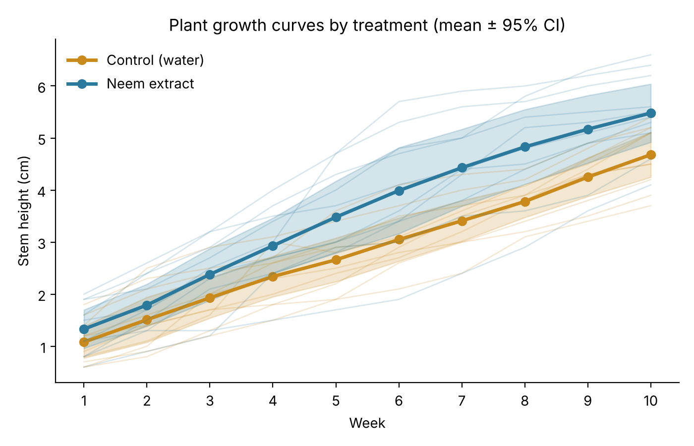

# AGRO-BHARAT — Neem-based fertilizer for bell pepper

**Development of a product with fertilizer function formulated from Indian Neem (*Azadirachta indica*) properties**

Monica Grenadier Macaes, Laura Franchini Placido — advisor: Dr. Juliana Izidoro
Colégio Dante Alighieri, São Paulo, Brazil · Junior Scientific Initiation Program "Cientista Aprendiz" (2024–2025)
TLC analysis in partnership with Dr. Anelize Bauermeister and Dr. Massuo Jorge Kato (IQ-USP)

This repository archives the experimental data and a fully reproducible statistical analysis of the study.

## Research question

Can an ethanolic extract of Neem leaves act as a natural fertilizer, increasing the growth of bell pepper (*Capsicum annuum*) seedlings compared with water alone?

## Experimental design

| Item | Detail |
|---|---|
| Treatment | 0.1977 g dried ethanolic Neem leaf extract diluted to 200 mL water; 1 mL applied at the root |
| Control | Water only |
| Subjects | 10 plants per group (20 total), sown 28 Mar 2025 |
| Outcome | Stem height (cm), measured weekly |
| Duration | 10 weeks (4 Apr – 7 Jun 2025) |
| Location | Biotechnology Lab, Colégio Dante Alighieri, São Paulo (23°33′S, 46°38′W) |

## Key results



**Two-way mixed ANOVA** (between: group; within: week):

| Effect | SS | df | F | p | p (Greenhouse-Geisser) | ηp² |
|---|---|---|---|---|---|---|
| Group (Neem vs Control) | 25.35 | 1, 18 | 6.38 | **0.021** | — | 0.26 |
| Week | 309.22 | 9, 162 | 259.09 | **< 0.001** | < 0.001 | 0.94 |
| Group × Week | 4.04 | 9, 162 | 3.38 | **0.001** | **0.040** | 0.16 |

**Growth rate** (linear mixed model, random intercept and slope per plant):

- Control: **0.390 cm/week**
- Neem: **0.474 cm/week** (+0.084 cm/week; p = 0.036 with a large-sample z-test in Python, p = 0.051 with the small-sample Satterthwaite t-test in R)
- By week 10, mean height was 5.48 cm (Neem) vs 4.68 cm (Control); the gap widened from 0.25 cm at week 1 to 0.80 cm at week 10.

These numbers reproduce the values reported in the paper. Python (pingouin/statsmodels) and R (afex/lmerTest) give identical ANOVA tables; full R output is in [`results/R_output.txt`](results/R_output.txt).

### Interpretation

1. Plants grew over time (expected; week effect).
2. Neem-treated plants were taller overall (group effect, p = 0.021, moderate-to-large effect ηp² = 0.26).
3. Neem plants grew **faster**, not just started larger (interaction, p = 0.001; still significant at p = 0.040 after Greenhouse-Geisser correction for the violated sphericity assumption).

### Limitations (stated honestly)

- **Small sample** (n = 10 per group). Week-by-week Welch t-tests are significant uncorrected at weeks 5–10, but none survive Holm correction for 10 comparisons (smallest adjusted p = 0.07, week 8). The overall effect is detected by the ANOVA/mixed model, which pools all weeks.
- **Sphericity is violated** (Mauchly p < 0.001), so the corrected interaction p (0.040) is the conservative one to cite.
- The growth-rate difference on its own is **borderline**: per-plant slope t-test p = 0.053, mixed model p = 0.036 (z-test) or p = 0.051 (Satterthwaite, the more conservative small-sample version). The interaction in the mixed ANOVA (p = 0.040 GG-corrected) is the main evidence that Neem plants grew faster.
- Plants were not watered on Sundays or on Good Friday (lab closed). This affected both groups equally.
- The TLC analysis used methanol (not ethanol, which was used for the applied extract), since methanol cannot be used in a school lab.
- Only the fertilizer effect was tested; the pesticide effect of Neem was not.

Assumption checks (Shapiro-Wilk per cell, Levene per week) are in [`results/statistical_report.txt`](results/statistical_report.txt).

## Repository structure

```
data/
  plant_height_long.csv        # raw data, one row per plant per week (200 rows)
analysis/
  analysis.py                  # full analysis (Python) — produces everything in results/
  analysis.R                   # same analysis in R (afex + lmerTest)
results/
  statistical_report.txt       # complete text output of the Python analysis
  R_output.txt                 # complete text output of the R analysis
  descriptive_stats.csv        # mean, SD, min, max, 95% CI by week and group
  mixed_anova.csv              # ANOVA table
  posthoc_group_by_week.csv    # Neem vs Control at each week
  per_plant_growth_slopes.csv  # linear growth rate of each plant
  figures/                     # growth curves, weekly means, growth slopes
docs/
  paper_summary.md             # summary of methods and chemistry (TLC)
```

## Reproduce

**Python**
```bash
pip install -r requirements.txt
python analysis/analysis.py
```

**R**
```r
install.packages(c("afex", "emmeans", "lme4", "lmerTest", "ggplot2"))
```
```bash
Rscript analysis/analysis.R
```

## Data dictionary (`data/plant_height_long.csv`)

| Column | Description |
|---|---|
| `plant_id` | Unique plant ID (`COG-01`…`COG-10` control, `NGR-01`…`NGR-10` Neem) |
| `group` | `control` (water) or `neem` (Neem extract) |
| `vase` | Vase number within the group (1–10) |
| `week` | Measurement week (1–10) |
| `date` | Measurement date |
| `height_cm` | Stem length in cm (standard ruler) |

## Acknowledgments

Laura Labaki and Cristina Pool (Colégio Dante Alighieri); Edgar Lombardi, Dr. Massuo Jorge Kato and Dr. Anelize Bauermeister (IQ-USP).
